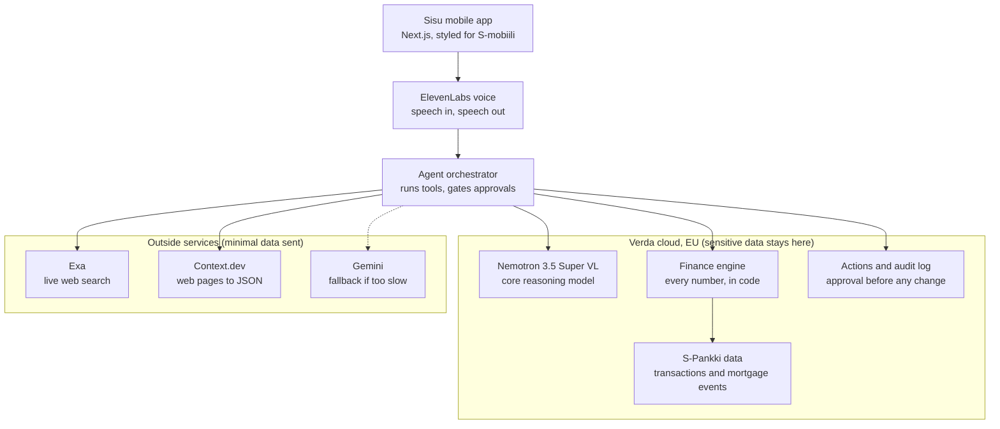

# Sisu architecture

## Layer stack



## The data boundary

- Raw transactions stay in the finance engine. The model sees only customer-scoped aggregates and selected facts that the tools return.
- Exa and Context.dev queries contain only the bill type and city, for example "electricity contract Helsinki". They never contain customer IDs, amounts or history.
- Every tool result carries its source and retrieval time.
- Nothing changes state without an approval event, and every approval is logged.

## Reasoning model: Nemotron first, two fallbacks

All three speak the OpenAI chat-completions format, so `MODEL_PROVIDER` switches between them with no code change.

| Order | Where | When we use it | Caveat |
|---|---|---|---|
| 1 | **Nemotron 3.5 Super VL self-hosted on Verda** (vLLM, OpenAI-compatible server on a GPU instance) | Default, if it is serving by the **Sat 10:00** gate | Verda's hosted inference list (Kimi, DeepSeek, GLM) does **not** include Nemotron, so we run it ourselves. Ask Verda (booth 6, 3rd floor) which GPU fits a 120B MoE model in FP8 within our €200 credits. |
| 2 | **NVIDIA Build hosted endpoint**: `https://integrate.api.nvidia.com/v1`, model `nvidia/nemotron-3.5-super-vl-120b-a12b` | If Verda is not serving by Sat 10:00 | The free trial logs inputs and outputs. Send only aggregates; this weakens the "data stays in the EU" pitch. |
| 3 | **Gemini** (OpenAI-compatible endpoint) | Voice path only, if a Nemotron turn takes over 8 s | Keep Nemotron on the typed ask box so the NVIDIA track still holds. |

The NVIDIA track requires Super VL itself. The smaller `nemotron-3.5-lightning-30b-a3b` does not count.

## What each tool does, and whether it earns its place

| Tool | Job in Sisu | Verdict |
|---|---|---|
| **Nemotron 3.5 Super VL** (NVIDIA Build now, Verda later) | Reads the question, chooses which finance or research tool to call, and explains the result in plain words. It never does the maths. | **Essential.** It is the agent's brain and is required for the NVIDIA track. The vision part is optional (stretch: read a photographed bill). |
| **ElevenLabs** speech to text and text to speech | Turns the judge's voice into text and Sisu's answer into speech. | **Essential.** Voice is required. It is also the stage where seconds are easy to lose; see the latency plan below. |
| **Exa** | Finds today's Finnish offers and rules the model cannot know, with URLs. | **Essential.** Without it the "live research" step is fake. `fast` mode returns 5 results in 0.55 s. |
| **Context.dev** | Turns each offer page into typed fields (provider, price, term, fees) so code can compute the saving. | **Useful, with some overlap.** Exa can return page text too. Context.dev earns its place by producing typed JSON with per-format `success` flags, and the prize needs it visibly in the core flow. Fresh reads are the slowest step (1–4.3 s), so prefetch them. |
| **Verda** | Runs Nemotron on our own EU GPU (and could host the backend). | **Pitch value high; build cost high.** The "bank data stays in the EU" story is strong, but NVIDIA's hosted endpoint already answers in 0.54 s. Do it after the main flow works, and switch only if it is as fast. |
| **Gemini** | Backup model. | **Probably not needed.** Nemotron with thinking off is fast enough. Keep the switch in case NVIDIA rate-limits us during judging; skip it otherwise. |
| **Supabase / Postgres** | Remembers confirmed bill names and goals between sessions. | **Small but needed** for the "remembers you" acceptance test. |

## Latency plan for live voice demos

Measured on 14 Nov from Espoo on NVIDIA Build, Exa, Context.dev and ElevenLabs. These are single runs, so treat them as rough figures.

| Stage | Measured | Choice |
|---|---|---|
| Nemotron, thinking **on** (default) | 3.10 s to first answer word (it writes about 1,500 characters of hidden reasoning first) | Only for slow "plan" tasks in the typed ask box |
| Nemotron, thinking **off** (`chat_template_kwargs: {"enable_thinking": false}`) | **0.54 s** to first word, 0.95 s for a full two-sentence answer | **Default for every conversation turn** |
| Nemotron tool choice, thinking off | **0.88 s**, same correct tool and arguments as with thinking on (1.42 s) | Default |
| `/no_think` in the system prompt | Did **not** turn thinking off (3.25 s) | Don't use |
| Exa search, `type: "fast"` / `"auto"` | **0.55 s** / 1.16 s for 5 results | `fast` |
| Context.dev scrape, 3 pages in parallel, fresh (`maxAgeMs: 0` at the top level of the body) | 1.07 s, 1.91 s, 4.33 s | 2.5 s budget; prefetch on bill confirm |
| Context.dev, cached (default, up to 3 days old) | 0.39–0.52 s | Fallback when the fresh read times out. Label it with its cache age. |
| ElevenLabs TTS, first audio: `eleven_turbo_v2_5` / `eleven_v4_turbo` / `eleven_flash_v2_5` / `eleven_v4` | **0.24 s** / 0.34 s / 0.46 s / 0.76 s | `eleven_turbo_v2_5`; try `eleven_v4_turbo` if quality matters more |
| ElevenLabs speech to text | Not measured yet | Measure with a real recording |

**Targets.**
- A question about the user's own numbers starts answering aloud in about 2 s: speech to text, one tool call (0.9 s), the answer starting (0.5 s), then text to speech (0.25 s).
- A live-offer question takes about 3 s with prefetch, or about 6 s cold. Its spoken acknowledgement starts at once.

**Rules that keep it fast.**
1. **Stream everything.** The orchestrator sends tokens over server-sent events, and each finished sentence goes straight to text to speech. Never wait for the whole answer.
2. **Thinking off for conversation.** It cut first-word time by 2.5 s in testing, with the same tool choice.
3. **Give the model the customer's summary up front.** The finance engine's overview, all computed in code, goes in the system prompt. Many questions then need no tool round trip, and the trace still shows where each number came from.
4. **Prefetch the slow part.** When the user confirms the bill, start Exa and Context.dev in the background. Show the retrieval time, so judges can see the data is real and recent.
5. **Never leave silence.** For slow tools, play a pre-generated clip at once ("Checking current electricity deals in Helsinki…").
6. **Parallel calls and hard timeouts.** Read pages in parallel and answer with whatever arrived inside the budget. Say what could not be checked.
7. **Short spoken answers.** Two sentences and rounded euros for voice; the screen shows the detail. Use `max_tokens` around 250.
8. **Push to talk, not automatic detection.** A noisy booth breaks voice-activity detection. A held button is faster and more reliable.
9. **Run the server in the EU, close to Espoo.** Reuse one HTTP client so connections stay open.
10. **Show the timings.** Each step in the trace drawer shows its milliseconds. It helps debugging and impresses judges.

**Risk:** NVIDIA Build is a free trial with rate limits. Ask the NVIDIA mentor what the limits are. Keep Verda or Gemini ready as a switch in case judging traffic hits them.

## Environment variables (`.env.example`)

```
MODEL_PROVIDER=        # mock | nvidia | verda | gemini  (mock = no keys needed)
NEMOTRON_THINKING=     # off for conversation (default), on for slow planning tasks
ELEVENLABS_TTS_MODEL=  # eleven_turbo_v2_5 (fastest measured)
ELEVENLABS_VOICE_ID=   # any voice from the account
NEMOTRON_BASE_URL=     # Verda vLLM URL, or https://integrate.api.nvidia.com/v1
NEMOTRON_API_KEY=
NEMOTRON_MODEL=        # nvidia/nemotron-3.5-super-vl-120b-a12b
GEMINI_API_KEY=
EXA_API_KEY=
CONTEXT_DEV_API_KEY=
ELEVENLABS_API_KEY=
```

Keys go in `.env.local` only. Never commit them, and never paste them into the team chat.

## What already exists in this repo

| Piece | Where |
|---|---|
| Reduced demo data (3 customers, about 300 KB) | `data/` (built by `scripts/reduce.sh` from the official CSVs) |
| Basket mapping, recurring-bill detection, safe-to-spend, peer comparison, insights | `lib/finance/` |
| Futures simulator (three branches, 1/5/8% return band, 0.2% fund fee) | `lib/finance/scenario.ts`, `components/FuturesCard.tsx` |
| Mobile UI: picker, safe-to-spend, insights, baskets, bills, futures, cash-flow chart, evidence sheet | `app/page.tsx`, `components/` |
| API contract types | `lib/types.ts` |
