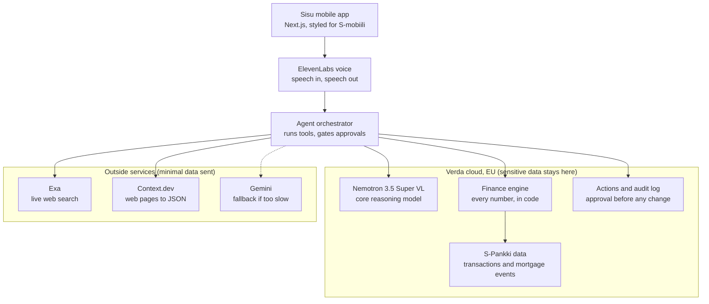

# Sisu architecture

## Layer stack



## The data boundary

- Raw transactions stay in the finance engine. The model sees only customer-scoped aggregates and selected facts that the tools return.
- Exa and Context.dev queries contain only the bill type and city, for example "electricity contract Helsinki". They never contain customer IDs, amounts or history.
- Every tool result carries its source and retrieval time.
- Nothing changes state without an approval event, and every approval is logged.

## Reasoning model: Nemotron first, two fallbacks

All three speak the OpenAI chat-completions format, so `MODEL_PROVIDER` switches between them with no code change.

| Order | Where | When we use it | Caveat |
|---|---|---|---|
| 1 | **Nemotron 3.5 Super VL self-hosted on Verda** (vLLM, OpenAI-compatible server on a GPU instance) | Default, if it is serving by the **Sat 10:00** gate | Verda's hosted inference list (Kimi, DeepSeek, GLM) does **not** include Nemotron, so we run it ourselves. Ask Verda (booth 6, 3rd floor) which GPU fits a 120B MoE model in FP8 within our €200 credits. |
| 2 | **NVIDIA Build hosted endpoint**: `https://integrate.api.nvidia.com/v1`, model `nvidia/nemotron-3.5-super-vl-120b-a12b` | If Verda is not serving by Sat 10:00 | The free trial logs inputs and outputs. Send only aggregates; this weakens the "data stays in the EU" pitch. |
| 3 | **Gemini** (OpenAI-compatible endpoint) | Voice path only, if a Nemotron turn takes over 8 s | Keep Nemotron on the typed ask box so the NVIDIA track still holds. |

The NVIDIA track requires Super VL itself. The smaller `nemotron-3.5-lightning-30b-a3b` does not count.

## Environment variables (`.env.example`)

```
MODEL_PROVIDER=        # verda | nvidia | gemini
NEMOTRON_BASE_URL=     # Verda vLLM URL, or https://integrate.api.nvidia.com/v1
NEMOTRON_API_KEY=
NEMOTRON_MODEL=        # nvidia/nemotron-3.5-super-vl-120b-a12b
GEMINI_API_KEY=
EXA_API_KEY=
CONTEXT_DEV_API_KEY=
ELEVENLABS_API_KEY=
```

Keys go in `.env.local` only. Never commit them, and never paste them into the team chat.

## What already exists in this repo

| Piece | Where |
|---|---|
| Reduced demo data (3 customers, about 300 KB) | `data/` (built by `scripts/reduce.sh` from the official CSVs) |
| Basket mapping, recurring-bill detection, safe-to-spend, peer comparison, insights | `lib/finance/` |
| Futures simulator (three branches, 1/5/8% return band, 0.2% fund fee) | `lib/finance/scenario.ts`, `components/FuturesCard.tsx` |
| Mobile UI: picker, safe-to-spend, insights, baskets, bills, futures, cash-flow chart, evidence sheet | `app/page.tsx`, `components/` |
| API contract types | `lib/types.ts` |
