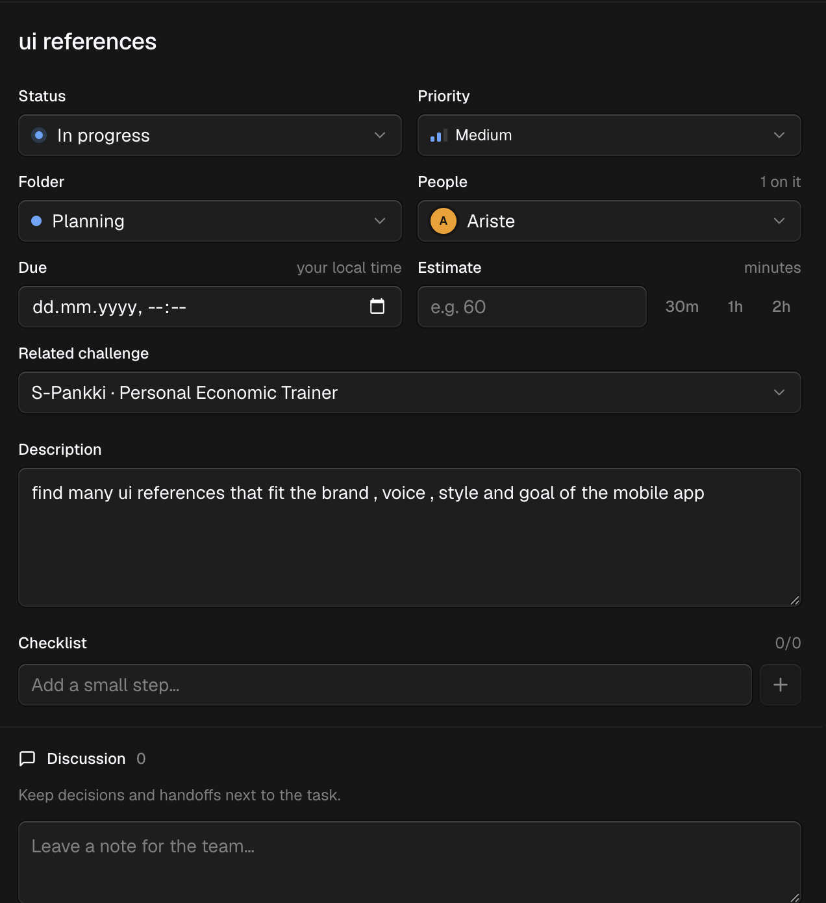
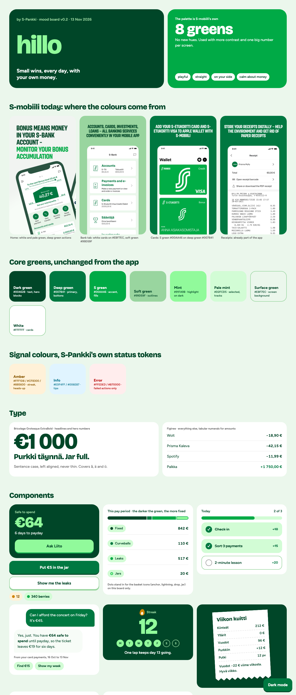
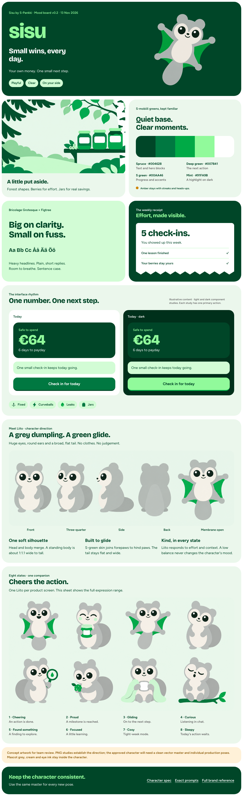

# Sisu brand kit and asset generation

Source: <t3-thread://v2/699bd055-6afa-4ddf-9c94-4b70358a24dd/9bd03a63-a893-442d-9b8e-8004ddd29fa7>

Source updated: 2026-11-13T21:33:03.967Z. Coverage: complete accessible user and assistant messages. Tool traces are omitted.

Historical record. Later user corrections and current repository instructions take precedence. Local project links point at the verified asset commit; personal emails are redacted. Older completion claims are preserved as history, not independent proof.

## User · 2026-11-13T19:37:28.671Z

hey

## Assistant · 2026-11-13T19:37:31.982Z

Hey! I'm in the `s-banking` repo, which only has its initial commit so far. What do you want to work on?

## User · 2026-11-13T19:51:06.526Z

were going to redesing the branding kit of the s banking , a finnish banking that has over the majority of the coutry as clients , they are the biggest beank in finland, we are tasked with   finding ui references , and making a whole read only branch in the github that will help consistently  generate ui that is on point accross chats and ai's , we will really find the current brand style of the current brand out and we will answer it using the same colors and maybe make an upgraded color pallet.  I was thinking maybe more of a Duolingo-like interaction with the client, with the target audience, because, of course, our target audience is people between the ages of 18 and 35. We kind of want to have that interaction be an interesting and dopamine-giving. I also want you to help me make a persona for this app. Like I said, from people aged 18 to 35: people who don't know how to save, people who ideally don't have too much money, maybe people who have under 20,000 a month I need people who are in some sort of situation where they have the need to budget, try and optimize their costs, and cut down their costs. Basically people who have a lot of unnecessary spending, where there's really room for improvement on their spending habits and they could save a lot and invest a lot. Using the App Lama connectors, I want you to find UI references for the type of app that I'm describing right now. You're also going to help me make a little branding kit using ChatGPT. You're going to be using the model source 6.1 on extra high as a subagent, which will be generating the images that we need. You will also be making a mood board, which kind of has to relate to the UI and the type of graphics that we would see within the UI. If you have any questions for me, please ask them because I really want to clarify to you so that you have a clear idea of what I want and what I am looking for. 
The branding kit should include the following:
- the brand voice
- the colors
- the UI style
- the specifications
- the unique identity
- the personality, etc., I'm also going to need you to run a competitor analysis. You are going to do a competitor analysis in terms of UI and in terms of brand strategy. This is not specifically for banks. It doesn't have to be competitors that are competitors of the bank. It would be more about competitors that we could have building this product. Maybe, for example, apps on the App Store that have a really good UI and are supposed to help you save money, stuff like this. You get what I mean?

## Assistant · 2026-11-13T19:54:53.004Z

Setup is done (new `brand-kit` branch, project note saved). Now starting three research passes in parallel: the current S-Pankki brand, competitor apps, and Appllama UI references.

## Assistant · 2026-11-13T20:16:23.949Z

All three research passes are back. Looking at the top references myself before writing the kit.

## Assistant · 2026-11-13T20:17:57.263Z

Research is done and I'm writing the brand kit files now. The brief sets a preliminary submission deadline of tonight at 23:55, which you should know about right away.

## Assistant · 2026-11-13T20:22:16.031Z

Core kit files are written (brief, persona, identity, voice, colors, UI style, specs, tokens). Now adding the image prompts, the AI instructions file, and the mood board page.

## Assistant · 2026-11-13T20:24:45.169Z

All kit files and the mood board page are written. Rendering the mood board now to check it looks right, then I'll commit and push the branch.

## Assistant · 2026-11-13T20:25:33.949Z

The brand kit v0.1 is pushed to the `brand-kit` branch of `riripatate/s-banking`. It has everything you asked for except the generated images, which are waiting on T3.

Here is the mood board as it renders now (palette, type and components built from the kit's tokens):

## Check before you rely on it
- **Preliminary submission is tonight at 23:55**, according to junction2026.com. That site is not confirmed as official, so check it at the venue.
- **The brief asks for an AI chat, not a rebrand.** Its core line is "chat with their own money", built on three spending baskets: mandatory regular, mandatory irregular, and everyday spending that slips away. I built the kit around the chat and those baskets.
- **S-Pankki is not Finland's biggest bank.** It has 3.5 million customers but only about 3.4 % of loans; OP and Nordea are far larger. Don't say "biggest" in the pitch.
- **The branch can't be locked.** GitHub only allows branch protection on a private repo with Pro, so read-only is a rule written in `AGENTS.md`, not enforced.

## What's in the branch
- **Brand kit** (`brand/`): persona, identity and mascot, voice, colours, UI style, specifications, design tokens and 16 image prompts.
- **Persona**: Aino, 24, Tampere, about €1,750 net a month, with roughly €220 a month of recoverable leaks. Her budget is illustrative; the statistics around it are sourced.
- **Colours**: S-Pankki's real greens, read from their live site and kept unchanged, plus four new "berry" colours that each mean one thing. Contrast ratios are checked.
- **Competitor analysis**: 18 finance products plus Duolingo, Finch and Headspace, on UI and brand strategy. The gap it finds is that nothing in Finland is playful, mascot-led, built on real transactions, free and not selling credit.
- **UI references**: 90 screens from 25 apps via Appllama, with a pattern library and a top 15. This used 67 of your 1,500 monthly credits.
- **`AGENTS.md`**: the rules and checklist any AI should follow to generate matching UI.

## Proposals I made that need your yes
- **Name: Hillo.** It means jam in Finnish and, I believe, is also slang for money; confirm that with a Finnish speaker. It gives the product its picture language: effort earns berries, savings goals are jars. Not checked for trademarks.
- **Mascot: Liito, a Siberian flying squirrel.** Grey with huge eyes and a green-lined glide. Its mood follows the user's effort, never their balance, so it is never sad or guilt-tripping.
- **Fonts: Bricolage Grotesque and Figtree.** S-Pankki's own fonts are proprietary.
- **Basket names: Fixed, Curveballs, Leaks** (Kiinteät, Yllärit, Vuodot). All Finnish copy in the kit needs a native check.

## Not done
- **Images**: no mascot art, brand kit images or mood board tiles exist yet. The mood board page has empty slots that fill in when files land in `moodboard/generated/`.
- **Colour-blindness test** of the chart colours.

Once T3 Code is restarted so delegation works, tell me and I'll generate the images with gpt-6.1-sol at xhigh, starting with the Liito master sheet. If tonight's deadline matters more, say so and I'll run them through the Codex CLI instead.

To see the board live with dark mode, open [moodboard/index.html](https://github.com/Junction-2026-NMA/junction-2026/blob/0b58ea220fb93bd1dc0f19178afb23567ef57065/moodboard/index.html); to start reading the kit, open [README.md](https://github.com/Junction-2026-NMA/junction-2026/blob/0b58ea220fb93bd1dc0f19178afb23567ef57065/README.md).

## User · 2026-11-13T20:46:19.053Z

Put this in a Google Doc document.

## Assistant · 2026-11-13T20:47:01.635Z

Converted the eight brand kit chapters into one HTML file. Shrinking it, then uploading to Google Drive as a Doc.

## Assistant · 2026-11-13T20:47:38.649Z

The HTML is ready (about 30,000 words of markup). Creating the Google Doc now.

## Assistant · 2026-11-13T20:51:11.807Z

I put the brand kit in a Google Doc, [Hillo brand kit v0.1 (S-Pankki · Junction 2026)](https://docs.google.com/document/d/1oAlh40dRMHmywMyTKtX9tk8AiOq8mK-F0QXBKM5FgTs/edit), in the riripatate345 Google Drive. I read it back after creating it: all chapters and tables are there.

- **What's in it:** the brief, the persona, identity and mascot, voice, colours, UI style and specifications, all in full. Headings are real Doc headings, so the outline works.
- **What's only linked:** the image prompts chapter is one paragraph pointing to the full prompts on GitHub. The 16 prompts are long blocks of text meant for pasting into an image tool, and they would have doubled the doc's length.
- **Two small changes from the repo:** one voice example used a crying emoji, which the doc describes in words instead. I also fixed one list where the "yes" and "no" examples showed up as separate numbered rules.

The GitHub branch is still the source of truth, and the doc won't update when the repo changes.

The Google Docs connector isn't turned on in this chat, so I can create docs but not edit this one. If you want changes later, turn it on in the chat's connector settings and the edits will go into this same doc.

## User · 2026-11-13T20:53:44.494Z

i don't like the branding kit at all the colors really need to match the s - pankki mobile app, but ofcouse modernized and upgraded to fit

## Assistant · 2026-11-13T20:55:54.861Z

I checked the real S-mobiili screenshots and my palette had drifted, so I'm rebuilding it from the app's own white, pale green, and deep green colours.

## Assistant · 2026-11-13T20:57:25.839Z

New colour file and tokens are written. Now updating the rest of the kit (identity, UI style, specs, AI rules, mood board) so nothing still points at the old colours.

## User · 2026-11-13T20:58:52.110Z

continue

## Assistant · 2026-11-13T21:00:11.442Z

Mood board is re-rendered in the new palette. Checking it visually, then committing and pushing.

## Assistant · 2026-11-13T21:00:49.960Z

I rebuilt the palette from the real S-mobiili app and pushed it to `brand-kit` as kit v0.2. Every brand colour is now one the app or S-Pankki's own design tokens already use, with no new hues.

**What was wrong with v0.1:** it kept S-Pankki's greens in name only. I put a warm cream background behind everything, made a neon green the hero (S-Pankki only uses it on button hover), and added pink, violet, gold and orange. That made it look like a different company.

## What changed
- **Base look is the app's:** white cards on the pale green screen `#EBF7EC`, dark green `#004628` text. I sampled these from the App Store screenshots pixel by pixel.
- **Primary colour is deep green `#007841`** with a white label, like the round action buttons in the app. The S green `#00AA46` of the logo and cards is the accent.
- **The upgrade is in how the colours are used:** dark green hero blocks with one big mint `#91FA9B` number, buttons that press down, heavier type, and a dark mode built from the same greens.
- **The three baskets are a green ramp from dark to light:** the darker the green, the more fixed the money. They still carry an icon and a label.
- **The only non-green colours are S-Pankki's own status colours:** amber for the streak flame and heads-ups, blue for tips, red for errors.
- **Updated to match:** the identity, UI style, specs, tokens, AI rules and image prompts. The four S-mobiili screenshots are now in `references/s-mobiili/` as the colour reference.

## Things to know
- **The screenshots are old.** The store images are a few years out of date and I haven't seen the logged-in app. If you have S-mobiili on a phone, send me two or three current screenshots and I'll check the palette against them.
- **Another session's files went into my commit.** While I was working, something else added `brand/08-liito-character-spec.md` and two generated images (a Liito sheet and a forest pantry scene) to the same folder. My commit swept them in and pushed them. They already use the new green palette, so I left them alone; tell me if they shouldn't be on the branch.
- **The Google Doc still shows the old colours.** I can't edit it without the Google Docs connector turned on in this chat. Turn it on and I'll update that same doc, or I can create a fresh one.

You said you don't like the kit "at all", and I only fixed the colours. The fonts are the next biggest mismatch: S-Pankki's own headlines are condensed capitals, and mine are a rounded display face. Should I move the fonts closer to the app as well, and is anything else off (the name Hillo, the squirrel, the jars and berries idea)?

## User · 2026-11-13T21:02:17.378Z

app will be called siso , Spinner a GPT-6.06.1 subagent on ultra mode to make basically the entirety of the asset follow the branding that is supposed to be inside the app

## Assistant · 2026-11-13T21:02:54.399Z

The app is now called Siso across the whole kit, and that is pushed. I could not start the GPT-6.1 subagent: T3's delegation server is still not connected in this session (it is not answering at `127.0.0.1:3773`).

There are two ways to get the assets made:

- **Restart T3 Code** so delegation comes back, then tell me and I'll start the subagent as you asked.
- **Say "use Codex CLI"** and I'll run the same model (`gpt-6.1-sol`, ultra) from the terminal right now. Your Codex config is already set to that model and effort. I haven't done this on my own because last time you chose to wait for T3.

Either way the subagent gets the same brief: generate all 16 assets in `brand/07-image-prompts.md` (mascot sheets, app icon, jars, basket icons, stickers, mood board tiles) in the S-mobiili palette, Liito master sheet first, saved to `moodboard/generated/`.

What changed with the rename:

- The old name's jam story is gone from the identity chapter, since it no longer applies. Jars and berries stay as the product's picture language.
- The Google Doc still says Hillo and has the old colours.
- A file I didn't create, `moodboard/updated-board.html`, is in the folder from another session. I left it uncommitted.

## User · 2026-11-13T21:05:22.910Z

sisu, use codex cli to do what i asked

## Assistant · 2026-11-13T21:05:57.657Z

The name is now Sisu across the kit, and the image agent is running: `gpt-6.1-sol` at ultra effort through Codex CLI, started and confirmed working.

It is generating all 16 assets from `brand/07-image-prompts.md` into `moodboard/generated/`, in the S-mobiili greens, with the Liito master sheet as the reference for every image that contains the mascot. It checks each image against the kit's acceptance list and retries up to twice.

Two things to know while it runs:

- **Another session is editing the same folder.** Since my last push it has changed the image prompts, the Liito spec and the mood board page, and added SVG basket icons. I told the agent to keep any existing asset that passes the checks and never delete files it didn't create, but two agents writing to one folder can still collide.
- **The Sisu rename isn't committed yet.** It touches files the other session has also changed, so I'll commit everything together once the images are in, and show you the results then.

I'll report back when the agent finishes.

## User · 2026-11-13T21:23:36.991Z

I want you to continue and look at what the other session has made in terms of the mascot and assets, and continue based on that.

## Assistant · 2026-11-13T21:23:54.995Z

I looked at the other session's work, and it is good enough to build on rather than redo. I'm treating it as the base from here.

What it made, already committed to `brand-kit`:
- **Liito**: a five-view master sheet, an eight-mood sheet, and a transparent glide pose. The character is consistent across all of them: grey body, cream face, huge dark eyes, S green inside the glide membrane.
- **A better mood board** than mine (`moodboard/updated-board.html`), under the name Sisu, in the S-mobiili greens with light and dark "Today" studies.
- **Basket icons** as SVGs from Phosphor, a forest pantry scene, and a character spec with its own prompt file.

The image agent I started (gpt-6.1-sol, ultra) is still running and is building on that same master sheet. So far it has added the app icon, jar states, shelf, basket icon tiles, blank receipt, stickers, and berries and flame. It is now on the six mood tiles. Its own log flags slight shading and colour drift on several of these after three attempts each, so some will be concept quality, not final.

When it finishes I will:
1. Look at every new image and drop any that break the palette or the character.
2. Add the ones that pass to the other session's board, which becomes the main mood board.
3. Commit and push, then show you the full set.

## Assistant · 2026-11-13T21:33:03.946Z

The full Sisu asset set is done and pushed to `brand-kit`, built on the other session's Liito and shown on its mood board.

The gpt-6.1-sol agent (ultra, through Codex CLI) used the other session's master sheet as the reference for every image with Liito in it. I looked at all of the new images: they stay in the S-mobiili greens, and Liito is recognisably the same character throughout.

New in `moodboard/generated/`:
- **App icon:** Liito's face on S green.
- **System graphics:** basket icon tiles, jar states from empty to full, the shelf of jars, berries and the streak flame, a sticker set, and a blank weekly receipt.
- **Six mood tiles:** forest floor, pantry, payday glide, tight week, celebration, and a background pattern.

These are concept quality, not final art:
- **Shading and colour drift:** the agent's own strict check failed on every image after three attempts each. The greens are close to the palette but not exact hex values, and some shapes have slight shading.
- **Smaller defects:** two sheets came out 3:1 instead of 4:1, the master sheet's back view is missing the tail, and the pattern is not confirmed to tile seamlessly.
- **For production:** the icons, jars and Liito should be redrawn as vectors from these. The per-file defect list is in `moodboard/generated/README.md`.

`mood-forest-pantry.png`, the other session's image, shows as changed in my commit. I did not compare the two versions, so check that it still looks the way you want.

The main board is now [updated-board.html](https://github.com/Junction-2026-NMA/junction-2026/blob/0b58ea220fb93bd1dc0f19178afb23567ef57065/moodboard/updated-board.html); my older `index.html` board is still there, superseded and without the new assets.
