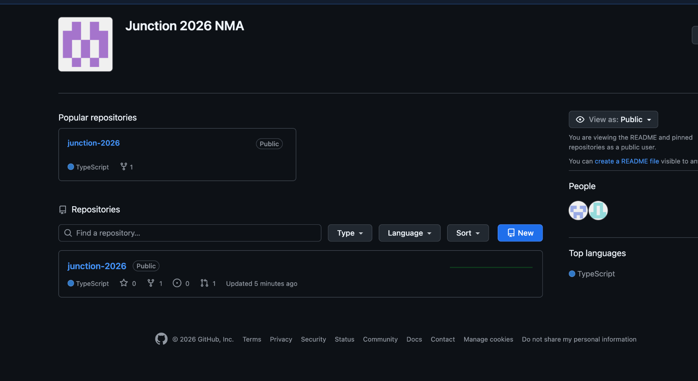

# Sisu repository migration conversation

Source: <t3-thread://v2/699bd055-6afa-4ddf-9c94-4b70358a24dd/e8277ef1-7681-410d-9a4a-886e07b88c59>

Source updated: 2026-11-13T21:37:21.448Z. Coverage: migration completion and follow-up request; current audit outcome in the team log. Tool traces are omitted.

Historical record. Later user corrections and current repository instructions take precedence. Local project links point at the verified asset commit; personal emails are redacted. Older completion claims are preserved as history, not independent proof.

## User · 2026-11-13T21:29:42.279Z

I need you to transfer everything we've done to this new organization and the specific repo.  , Even the ongoing work

## Assistant · 2026-11-13T21:29:49.123Z

I’ll find the destination repo, inventory the branches and work in progress, and transfer everything while preserving the work already in the new repo.

## Assistant · 2026-11-13T21:30:16.851Z

I found the brand-kit history and uncommitted artwork, including draft assets and QA images. I’m checking the destination and recent task records so that work in progress is included too.

## Assistant · 2026-11-13T21:30:56.156Z

The destination is [Junction-2026-NMA/junction-2026](https://github.com/Junction-2026-NMA/junction-2026). It already has an app scaffold and an open team PR. I’ll preserve those, copy the brand-kit history, save the unfinished assets on a WIP branch, and make this workspace use the new repo for future pushes.

## Assistant · 2026-11-13T21:33:00.739Z

The first snapshot is ready. The image task is still changing files, so I’m also preserving the state from the start of this transfer. That will keep the drafts and QA previews recoverable alongside the latest work.

## Assistant · 2026-11-13T21:34:09.444Z

The new repo now has the latest asset commit, the WIP snapshot, and an archive of the earlier QA files. This workspace’s `origin` points there. I’m checking the remote hashes and file contents; the team’s `main` branch and open PR remain untouched.

## Assistant · 2026-11-13T21:35:24.052Z

Transferred the project to [Junction-2026-NMA/junction-2026](https://github.com/Junction-2026-NMA/junction-2026).

- `brand-kit`: latest branding, mood board and assets.
- `wip/brand-assets-2026-11-13`: ongoing-work snapshot and continuation notes.
- `archive/*`: original main history and earlier QA previews.

Verified all 142 current files against the pushed commits. Future pushes now use the new repo. Its existing `main` and team PR are preserved.

Old PR discussions and the Google Doc remain at their original locations.

## User · 2026-11-13T21:35:42.215Z

Now look for the latest runs that just finished and latest conversations: make sure they're all in the new repo and everything's committed and pushed.
