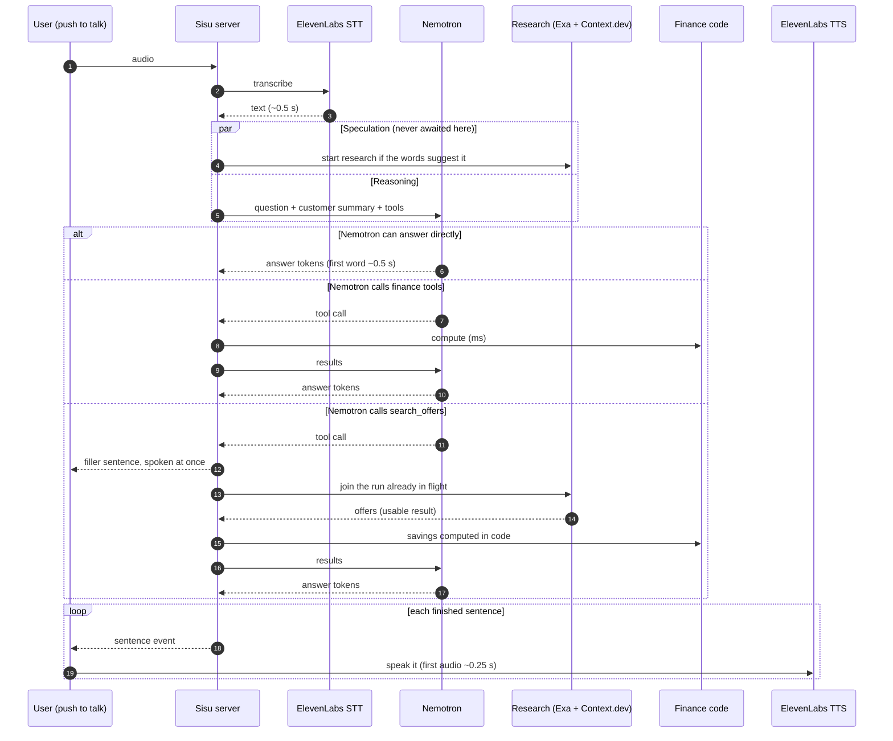

# Orchestration: how one turn runs, from speech to speech

Owner: Nicholas (lane C). Code: `lib/agent/`, `app/api/agent/`, `app/api/research/`, `app/api/voice/`.
This is the contract for how the tools run together. If the code and this file disagree, fix one of them.

## The one idea

**Slow work starts early and runs in the background. The model never waits for anything it did not ask for.**

- The slowest tool is Context.dev's JSON extraction (3–6 s). It starts the moment we can guess it will be needed, before the model has decided anything.
- Nemotron starts at the same time. If it can answer from the customer's numbers, it answers at once and the background research is simply kept for later.
- Only when Nemotron itself calls `search_offers` does the turn wait for research. It then joins the run that is already in flight instead of starting a second one.

## Stages and measured speed (14 Nov, Espoo, single runs)

| Stage | Tool and setting | Measured |
|---|---|---|
| Speech to text | ElevenLabs `scribe_v3` | 0.47 s for a 3 s clip |
| Reasoning, first word | Nemotron 3.5 Super VL, thinking off | 0.48–0.54 s |
| Reasoning, tool choice | Nemotron 3.5 Super VL, thinking off | 0.79–0.88 s |
| Finance tools | Our code in `lib/finance/`, in-process | under 5 ms |
| Web search | Exa `type: "lite"`, no page contents | 0.22 s |
| Web search with highlights | Exa `type: "lite"`, `contents.highlights` | 0.54 s |
| Offer extraction | Context.dev `formats.json` + `jsonParams.schema`, 3 pages in parallel | 2.8–5.9 s per page, even when the page itself is cached |
| Text to speech, first audio | ElevenLabs `eleven_turbo_v2_5` | 0.24 s |

### "Lite" models: what the tests showed

| Option | Result | Decision |
|---|---|---|
| Exa `lite` | 0.22 s. Exa's docs call `fast` and `instant` legacy names for it. | **Use `lite` everywhere.** |
| `nemotron-3.5-lightning-30b-a3b` (the "lite" Nemotron) | First word 0.38 s, tool choice 0.64 s. Correct tool call. | Saves about 0.1–0.15 s per step. **Optional**, behind `NEMOTRON_FAST_MODEL`, for the tool-choice step only. Off by default, because the NVIDIA prize needs Super VL to be the core model. |
| `nemotron-3.5-bolt-e4b` (smallest) | First word 0.28 s, but it **did not call the tool** when it should have. | **Do not use.** |
| Super VL with thinking on | 3.1 s to first word. | Only for typed, slow "plan" tasks. Never for voice. |

The big win was turning thinking off (2.5 s saved). The lite model is a small extra.

## One voice turn

## The rules

1. **Speculation.** When the transcript arrives, a keyword check (no model call, under 1 ms) decides whether research is likely. It needs a bill word *and* an intent word ("cheaper electricity deal"), or an intent word plus the bill the user has open on screen. If yes, research starts immediately. A wrong guess costs one Exa search and three Context.dev reads, nothing else.
2. **Earlier still.** When the user confirms a bill's name in the UI, the frontend calls `POST /api/research` with `wait: false`. By the time they ask, the offers are usually ready.
3. **Single flight.** Research is keyed by `billType + city`. Every caller with the same key (speculation, the UI prefetch, the model's tool call) shares one run. A finished result is reused for 10 minutes. This is what prevents duplicate calls and overlapping work.
4. **The model decides, not the speculation.** Nemotron gets the customer's computed summary in its prompt. If the answer is there, it answers without any tool. It is told explicitly to do so. Speculative research is never put in front of the model unless it calls the tool.
5. **Complete beats early.** A research wait ends when every page has been read or has failed, with a hard limit of 8.5 s. Answering from the first page alone was tried and dropped: the best offer and the saving changed from run to run. Rule 14 makes the wait rare.
6. **Never silence.** If the model calls `search_offers` and the result is not ready, the server sends a `filler` sentence at once ("Let me check today's electricity deals in Helsinki."). The client speaks it while research finishes.
7. **Tools run in parallel.** When the model asks for several tools in one step, they all start together. The loop is capped at 4 model steps.
8. **Streaming all the way.** Tokens stream from Nemotron. Each finished sentence is sent as its own event, and the client sends it to text to speech straight away. Sentences play in order.
9. **Numbers come from code.** Finance tools and the savings comparison run in `lib/finance/` and `lib/agent/research/compare.ts`. The model words the answer; it does not calculate.
10. **Privacy boundary.** The model sees aggregates only, never transactions or the customer ID. Exa and Context.dev queries are built by code from the bill type and city. The model's own `web_search` queries are stripped of IDs and euro amounts before they leave.
11. **Cancellation.** If the user talks again, the client aborts the request. The abort signal stops the model stream. Background research keeps running, because its result is still useful.
12. **Honest failure.** Every external call has a timeout. A tool that fails returns an error the model can explain ("I couldn't check live offers just now"). Nothing is invented, and cached results carry their real retrieval time.
13. **Savings are never overstated.** The bank data has no meter reading, so electricity use is estimated from the customer's own bill at today's typical fixed price. A bigger bill then means more use, not a bigger saving. If the customer states their yearly kWh, that is used instead, and the comparison counts at most 1.5 times the typical price as "energy"; the rest of the bill is treated as grid fees that switching cannot change. Test result: savings of 12 to 15% of the bill, where a flat 2,000 kWh assumption had claimed 60 to 81%.

## Measured turn times (built system, 14 Nov, `node tests/agent-latency.mjs`)

Times are from the moment the server has the text until the first sentence is ready to speak. For a voice turn add about 0.5 s of speech to text before and about 0.2 s of text to speech after.

| Question | What happened | First sentence ready |
|---|---|---|
| "How much can I safely spend this week?" | No tool; answered from the summary | 0.55–0.85 s |
| "How much do I pay for electricity each month?" | Mentions a bill but needs no research; none was started | 0.5–0.7 s |
| "How much did I spend on restaurants last month?" | `get_spending`, then the answer | 1.4–1.6 s |
| "What if I save fifty euros a month for five years?" | `run_scenario`, then the answer | 1.6–2.4 s |
| "What is the general housing allowance from Kela?" | `web_search` (Exa, 0.4 s), then the answer with 4 sources | 1.7–1.8 s |
| "Find me a cheaper electricity deal", research already done | Joined the cached result in 0 ms | 1.2–1.8 s |
| Same, cold | Research started at 0.0 s by speculation. Filler spoken at 1.3 s. First usable page at 3.8 s. | filler 1.3 s, answer 4.5 s |

Follow-through check: 16 of 16 repeated questions called the right tool (or correctly none).

**Known risk: tail latency.** One of those 16 runs took 7.0 s because NVIDIA's free endpoint stalled. Fixes to consider: a hedged second request when no token arrives within 1.5 s, or switching to Verda or Gemini for the demo.

## Endpoints

| Endpoint | Body | Returns |
|---|---|---|
| `POST /api/agent/query` | `{ customerId, text, mode: "voice" \| "text", history?, focusBill? }` | Server-sent events of `AgentEvent` (see `lib/types.ts`) |
| `POST /api/voice/turn` | multipart: `audio`, `customerId`, `history?`, `focusBill?` | The same event stream, starting with a `transcript` event |
| `POST /api/voice/stt` | multipart: `audio` | `{ text, tookMs }` |
| `POST /api/voice/tts` | `{ text }` | Audio stream (`audio/mpeg`) |
| `POST /api/research` | `{ customerId, billType, wait? }` | `ResearchResult`; with `wait: false` it returns at once with `status: "running"` |
| `GET /api/research?customerId=&billType=` | | Current `ResearchResult` snapshot, or 404 if none started |

Event order in one turn: `start`, (`transcript`), (`speculation`), then any mix of `tool_start`, `filler`, `tool_end`, `research`, `delta`, `sentence`, and finally `done` or `error`.

## Mock mode

`MODEL_PROVIDER=mock` needs no keys. Every endpoint works and emits the same events with realistic timing, using fixed example offers marked `mock: true`. The UI must show a "mock data" label when it sees that flag. Lanes A and B develop against this.

## Model switch

| `MODEL_PROVIDER` | Reasoning model |
|---|---|
| `mock` | Scripted answers, no network |
| `nvidia` | Nemotron 3.5 Super VL on NVIDIA Build. Now the backup. |
| `verda` | The same model self-hosted on our Verda GPU in Finland (`VERDA_BASE_URL`, `VERDA_API_KEY`). **Current default on Nicholas's machine**, measured at 0.09–0.18 s to first word. |
| `gemini` | Gemini through its OpenAI-compatible endpoint; emergency fallback only |

**Stall protection.** `MODEL_FALLBACK=nvidia` names a backup. If the main model returns an error, cannot be reached, or produces nothing within 2 s, the same request goes to the backup and each model step in `timings.modelSteps` records `provider` and `usedBackup`. Tested by cutting the tunnel to Verda: NVIDIA answered in 0.7 s, and Verda took over again when the tunnel returned. With the backup in use, aggregates (never transactions) reach NVIDIA, so say "backup" in the pitch if it shows.

14. **Offers are kept warm.** `GET /api/agent/warm` (called when the app opens) starts electricity research for the demo cities. A finished result is used as is for 10 minutes; up to an hour old it is still served at once, with its real retrieval time, while a fresh copy loads behind the scenes.
15. **The model's cache is primed.** Reading a customer's 2,000-token instructions takes our Verda GPU about 2 s the first time and about 0.2 s after that. The warm-up sends each demo customer's instructions once, so their first question is fast.
16. **Voice.** ElevenLabs `eleven_v4_turbo` (newest generation, about 0.3 s to first audio). Audio is streamed as raw samples and played as it arrives, and each sentence is sent with the previous one as context so the speech flows. The full `eleven_v4` sounds richest but takes about 1.1 s to start. Compare by ear on `/dev/agent`.

## Added on 14 Nov (branch `overnight/fable-lead`)

The full explanation is `docs/SISU_ARCHITECTURE_EXPLAINED.md`. The rules added to this contract:

17. **Receipts.** Every tool returns `facts`: each number, its source (`bank-data`, `exa`, `context.dev`, `calculation`, `assumption`, `customer-stated`) and, where it has one, the filter that opens its transactions.
18. **Every number is checked.** When a sentence is complete, code checks its numbers against the receipts (`lib/agent/grounding.ts`). A figure copied with a slipped digit is replaced by the receipt's value before it is shown or spoken. The turn ends with a `grounding` event; a number with no source is listed there.
19. **The model never does arithmetic.** Projections go through `run_scenario`, one-off costs through `check_affordability`, and `find_patterns` hands over any total ready-made.
20. **Eleven tools.** Added: `list_bills`, `get_cash_flow`, `find_patterns`, `check_affordability`, `explain_concept`, `prepare_action`, `remember`. Each tool call also emits typed `stage` events for the UI.
21. **Common answers in one step.** Last month's spending by category and the payday outlook are in the customer summary, so those questions need no tool (0.44 s to the first sentence instead of 1.26 s).
22. **Approval is outside the model.** `prepare_action` only prepares, from data the server already holds. `POST /api/actions/:id/approve` with `confirm: true` is the only way an action is carried out, and it is a simulation. Every step is in a hash-chained audit log.
23. **Memory needs the customer's own words.** `remember` saves only what one of the customer's messages supports, and only with consent.
24. **Three kinds of outside text are untrusted:** web pages, bill photos and anything in the customer's message dressed up as a tool result or system message (`lib/agent/tools/untrusted.ts`).
25. **Investigation.** `POST /api/agent/investigate` runs the same loop with up to 9 model steps and a prompt that walks find, research, project, teach, prepare. If the model stops early it is told which step it skipped.
26. **Circuit breaker.** After the main model fails once, later steps go straight to the backup; a background probe every 5 s switches back (`lib/agent/breaker.ts`). The stall limit is 2 s and stops at the first token of any kind.
27. **Bill photos go only to the main model host**, never to the backup (`lib/agent/vision.ts`).
28. **Speech requests queue two at a time**, which is the ElevenLabs plan's limit.

Event order is now: `start`, (`transcript`), (`speculation`), (`filler`), then any mix of `tool_start`, `tool_end`, `research`, `stage`, `teaching`, `action`, `memory`, `delta`, `sentence`, then `grounding`, then `done`. Or `error`.

Measured turn times after these changes are in `docs/GAUNTLET_RESULTS.md`. One earlier claim in this file did not hold up when re-measured: priming the model per customer (rule 15) makes no measurable difference on our GPU (first token 257 ms repeated, 282 ms with the cache defeated). First-token time instead grows with prompt length, about 10 ms per 1,000 characters.
